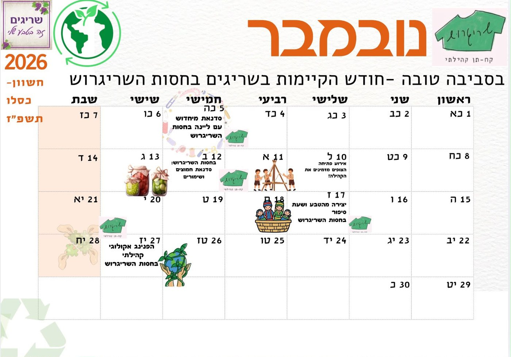

<!--
==================== מדריך עריכה קצר ====================
זה הקובץ שממנו בנוי כל התוכן באתר. משנים כאן, שומרים, והאתר מתעדכן תוך דקה או שתיים.

  ## כותרת {#מזהה}   = פרק חדש. את המזהה (באנגלית) לא משנים בפרקים קיימים.
  ### כותרת           = כותרת משנה בתוך פרק
  - טקסט             = שורה ברשימה
  **טקסט**           = הדגשה
  > טקסט             = תיבת הערה צבועה
  [טקסט](קישור)      = קישור
  טבלה               = שורות שמתחילות ונגמרות ב | (שומרים על אותו מספר עמודות)

טבלה עם עמודות "ימים" ו"שעות" = שעות פעילות. האתר מציג לבד אם פתוח עכשיו.
  ימים: "שני, רביעי" או "ראשון–חמישי". שעות: "16:00–18:00". חריגה: "(ברביעי מפנים ב-17:45)"

מועדי פינוי גושית: מעתיקים מלוח המועצה, מופרדים בפסיק. למשל: 9.11.2026, 23.11.2026
  האתר מציג את המועד הקרוב. אם אין מועד עתידי, מוצג קישור ללוח המועצה.

לוח אירועים: כל שורה בטבלה = אירוע. תאריך בפורמט 5.11.2026. אירועים שעברו נעלמים מהאתר לבד.
  בעמודת "הרשמה" שמים קישור כך: [להרשמה](https://...)
  פוסטר חודשי:  - מעלים את התמונה לתיקיית docs.

מספרי טלפון בפורמט 05X-XXXXXXX או 0X-XXXXXXX הופכים לבד ללחיצים.
אם משהו נשבר, תמיד אפשר לחזור לגרסה קודמת דרך History ב-GitHub.

השורות שמתחת לתיבה הזו (כותרת ראשית, פתיח, עודכן לאחרונה) מופיעות בראש האתר.
את השם שלפני הנקודתיים לא משנים, רק את הטקסט שאחריהן.
==========================================================
-->

כותרת ראשית: כל מה שצריך לדעת בשריגים, במקום אחד
פתיח: שכנות ושכנים יקרים, ריכזנו כאן את מה שחשוב לדעת כשגרים בשריגים, כדי שכל אחת ואחד יוכלו למצוא במהירות מה נהוג אצלנו, ושנשמור יחד על קהילה חזקה, שריגים נקייה, בטוחה ונעימה.
עודכן לאחרונה: 2 בנובמבר 2026
מועדי פינוי גושית: 9.11.2026, 23.11.2026
מזהה יומן גוגל: 

## לוח אירועים {#events}

### נובמבר 2026: בסביבה טובה

חודש הקיימות בשריגים בחסות השריגרוש. נובמבר קצת אחרת: פחות קונים, יותר מתחברים! החודש מחכות לנו פעילויות שמזמינות אותנו ליצור, לחדש, להתחבר לטבע ולבלות יחד כקהילה.

| תאריך | שעה | אירוע | מקום | תיאור | הרשמה |
| --- | --- | --- | --- | --- | --- |
| 5.11.2026 | 16:30 | 🎨 מיחדוש עם ליינה | מרכז החוגים | סדנה לילדי וילדות גיל היסודי, שבה נהפוך חולצות לתיקים ונגלה איך אפשר ליצור משהו חדש ממה שכבר יש לנו. ללא עלות. | [להרשמה](https://docs.google.com/forms/d/1f3mEWlaagbvrLV5V7MNudOse0bETMCLcQwCoHesb5A4/viewform) |
| 10.11.2026 | 16:30 | 🏕️ אירוע פתיחת הצופים | מגרש הצופים | הצופים פותחים את השנה ומזמינים את כל ילדי הישוב והקהילה להצטרף, להכיר ולחגוג יחד, עם משחקים ופעילויות לילדים. | |
| 12.11.2026 | 19:30 | 🫙 סדנת חמוצים ושימורים | מועדון גיל היהלום | מפגש למבוגרים סביב שימור מזון, תוצרת מקומית וצמצום בזבוז, בהנחיית מינדי לשם. מביאים 2 צנצנות זכוכית נקיות. ללא עלות. | [להרשמה](https://docs.google.com/forms/d/1_7vmBWL7UpOYBHc71Jt4glXh8aI5mim3BWTl-V1v0uQ/viewform) |
| 17.11.2026 | 16:30 | 📚 יצירה מהטבע ושעת סיפור | הספרייה | פעילות נעימה לקטנטנים ולקטנטנות בגיל הרך, עם סיפור ויצירה עם אביב יפה. | |
| 27.11.2026 | 13:30 | 🌍 הפנינג אקולוגי קהילתי | המיקום המדויק יפורסם בהמשך | נסיים את החודש במפגש לכל הקהילה, עם הזדמנות להיפגש, ליהנות ולקבל השראה לחיים קצת יותר מקיימים. | |

### יומן הישוב

[[יומן]]

## פסולת, גזם ומיחזור {#waste}

גזם נאסף בכל יום רביעי בבוקר, ופסולת גושית נאספת בימי שני, לפי לוח הפינויים של המועצה. את שתיהן מוציאים לרחוב **רק יום אחד לפני האיסוף**.

| סוג | מתי נאסף | מתי מוציאים לרחוב |
| --- | --- | --- |
| גזם | כל יום רביעי, בבוקר | ביום שלישי |
| פסולת גושית (גרוטאות) | ימי שני, לפי לוח המועצה | ביום ראשון שלפני |

- **איפה מניחים:** במקום נגיש למשאית, כמו מפרץ חניה, קצה מדרכה או עיקול הדרך. לא מאחורי רכבים, עצים או עמודים, ולא צמוד לגדרות.
- **ערמה אחת:** מפרידים גזם מגושית, ומצרפים לערמה קיימת במקום ליצור חדשה.
- **מה נאסף:** גושית היא רהיטים וחפצים, בלי זכוכית ובלי פסולת בניין. גזם הוא ענפים וצמחים בלבד, לא בבאלות ולא קרשים.
- **גזם בשאר ימות השבוע:** מרכזים בחצר, או מביאים לפינת הגזם ליד הגנ"ש ביציאה לכיוון הלולים. אין יותר פינת גזם ליד גן פלפלון.
- **קרטון:** מקופל, לקרטוניות שליד מגרש הכדורסל. קרטוני ביצים וקופסאות דגנים נכנסים למיכל הכחול, ופלסטיק וקלקר למיכל הכתום.
- **אכיפה:** על פסולת שהוצאה שלא ביום שלפני האיסוף, המועצה יכולה לתת קנס.
- **מועדים ושינויים:** מתפרסמים באתר המועצה ([m-yehuda.org.il/925](https://m-yehuda.org.il/925/)) ובהודעות מזכירת הישוב.

### סביבת הבית

- מכניסים את האשפה לתוך הפחים ולא מניחים לידם.
- אוספים עלים שנשרו מהגינה למדרכה, וגוזמים צמחייה שפולשת למדרכה.
- לא משליכים מגבונים לביוב, ומרוקנים מים עומדים כדי למנוע יתושים.
- שכנים שרוצים לחלוק פח ירוק מוזמנים לפנות לוועדת הסביבה (פרטים ב[אנשי קשר](#contacts)).

## מבני ציבור {#buildings}

מבני הציבור והשטחים הציבוריים שייכים לכל הקהילה. העיקרון המנחה הוא שימוש פתוח ומגוון לכמה שיותר תושבים, בתיאום מראש, והשארת המקום נקי לבאים אחרינו.

מבני הציבור בישוב הם מועדון הישוב ובתוכו הג׳ימבורי, גן פלפלון (מועדון גיל היהלום) ומרכז החוגים (קומה תחתונה).

- **פתוחים לכל התושבים:** אירועים קהילתיים מתקיימים ללא עלות. אירוע פרטי כרוך בתשלום לפי המחירון, והוא אפשרי לתושבי הישוב בלבד.
- **תיאום אירוע:** במייל לוועד, [sarigim.lion@gmail.com](mailto:sarigim.lion@gmail.com), או דרך מזכירת הישוב.
- **חדר המוזיקה:** פתוח לנגנים לחזרות, בתיאום מראש.

### אירועים פרטיים

אירוע פרטי במבני הציבור אפשרי לתושבי שריגים בלבד, בתשלום, ובהתחשבות בימים ובשעות של החוגים והעסקים הקבועים. כנסים, ימי עיון והשתלמויות אפשריים באישור הוועד ובתיאום מראש.

- **איפה:** הדשא במרכז החוגים או המועדון היישובי.
- **איך מזמינים:** שולחים מייל לוועד עם שם בעלי האירוע, תיאור האירוע, הגילאים ומספר המשתתפים הצפוי, ימים ושעות, המרחב המועדף, האם משתמשים בציוד הקיים או מביאים ציוד מבחוץ, וכמה זמן נדרש להקמה ולפירוק.
- **אוכל ושתייה:** לא בתוך מרכז החוגים, אלא רק בדשא או במטבחון.
- **שעות ורעש:** האירוע מסתיים עד 23:00, ברמת רעש סבירה לאורך כל האירוע, בהתחשבות בשכנים ובדיירי כפר שמעון שליד מרכז החוגים.
- **מה לא מאושר:** הדלקת אש בלי אישור מראש מהוועד, ומסיבות פתוחות לקהל עם מכירת כרטיסים.
- **ניקיון:** מחזירים את המקום נקי ומסודר. פסולת זורקים לפחים שליד המבנה, ואם הם מלאים, לפח אחר. לא משאירים פסולת במבנה, ליד הפחים או מעל מכסה הפח.
- **דמי ביטחון ותשלום:** מפקידים צ'ק ביטחון אצל מזכירת הישוב, והוא מוחזר אחרי שמוודאים שהמקום נקי ושלם. את התשלום מעבירים לחשבון הוועד לפני האירוע.
- [לתקנון המלא לאירועים פרטיים (PDF)](docs/events-rules.pdf)

### סדנאות במבני הציבור

סדנה היא פעילות חד-פעמית או קבועה, ביום ובשעות מוגדרים ולתקופה מוגדרת, עם תשלום מהמשתתפים. הרישום לסדנה פתוח לכל תושבי שריגים שעומדים בדרישות הגיל או הרמה, ומספר המשתתפים נקבע לפי גודל החלל.

- **תיאום:** שולחים מייל לוועד עם פרטי ההתעניינות, ומקפידים על הימים והשעות שתואמו.
- **סדנה ארוכה:** סדנה של יותר מ-4 שעות שצריכה חלל בבלעדיות נחשבת אירוע.
- **שימוש משותף:** המבנים משמשים את כל הגילאים, ולכן ייתכן שימוש מקביל בחללים אחרים או חלוקת זמנים באותו חלל.
- **מפתח:** לא מעבירים ולא משכפלים את המפתח שקיבלתם.
- **בסיום:** מחזירים את הריהוט למקום, זורקים אשפה ומעבירים מטאטא. מכבים אורות ומזגן ונועלים, אם אין פעילות אחריכם. מתכננים 15 דקות הפסקה בין פעילות לפעילות.
- **נזק ותקלות:** נזק שנגרם במהלך הפעילות באחריות המפעיל. על תקלה מעדכנים את נציג הוועד שאיתו תואמה הפעילות או את מזכירת הישוב.
- **עוד כללים:** שומרים על רמת רעש סבירה, ולא מדליקים אש בלי אישור מראש מהוועד. התשלום לפי המחירון, בהעברה בנקאית בין ה-1 ל-5 בכל חודש.
- [לתקנון המלא לסדנאות (PDF)](docs/workshops-rules.pdf)

## הג׳ימבורי {#gym}

חדר הג׳ימבורי לגיל הרך נמצא במועדון הישוב ופתוח לתושבות ותושבי שריגים. כולם מוזמנים להתנדב, לפתוח ולבלות עם חברים.

| מתי | ימים | שעות |
| --- | --- | --- |
| בוקר | ראשון, שלישי, רביעי, חמישי | 10:00–13:00 |
| אחר הצהריים | שני, שלישי, רביעי, חמישי | 16:00–18:00 (ברביעי מפנים ב-17:45) |
| סוף שבוע | שישי | 10:00–18:00 |
| סוף שבוע | שבת | 9:00–18:00 |

> בשישי ובשבת הג׳ימבורי פתוח רק כשאין אירוע אחר במקום. פתיחה מחוץ לשעות האלה רק בתיאום ובאישור הוועד.

- **מפתח:** נמצא בתיבת מפתח עם קוד. את הקוד מקבלים בפרטי ממעיין, מלילך או מתמר. לא מעבירים ולא משכפלים את המפתח, ומחזירים אותו לתיבה.
- **אוכל:** לא אוכלים בחדר הג׳ימבורי או במועדון, גם לא ממתקים. אפשר לאכול בחוץ, על הספסל.
- **נעליים:** מורידים בכניסה, ובחורף נזהרים לא להכניס בוץ.
- **בסיום:** מחזירים ריהוט ומשחקים למקום, מוציאים זבל לפח שבמטבח, מכבים אורות ומזגן, ונועלים את הדלת אם אין פעילות אחריכם.
- **בהתחשבות:** מסיימים בזמן ומשאירים זמן לסידור לפני הפעילות הבאה, ושומרים על רמת רעש סבירה.
- **תקלות:** לכלוך, נזילה, תקלת אינטרנט, אור מהבהב או נזק לריהוט מעדכנים את מזכירת הישוב בהקדם.

## ספריית שריגים {#library}

הספרייה עברה למתכונת חדשה: היא נמצאת במרכז החוגים, ומעכשיו לא צריך לחכות לשעות פתיחה. בכל השעות שמרכז החוגים פתוח, אפשר להיכנס לבד עם המפתח והקוד.

| ימים | שעות |
| --- | --- |
| ראשון | 09:00–11:45 וגם 14:00–16:45 |
| שני | 14:00–18:00 |
| שלישי | 09:00–11:45 וגם 14:00–20:00 |
| רביעי | 14:00–19:30 |
| חמישי | 14:00–18:00 |

> **שעת ספרייה עם צוות:** בימי שלישי בין 16:30 ל-17:30 הספרייה פתוחה גם עם צוות המתנדבות.

חשוב לזכור שזהו מבנה ציבורי לכל קהילת שריגים: לפני היציאה מוודאים שהאור והמזגן כבויים, הדלת נעולה והמפתח חזר לכספת.

- **מי נכנס:** תושבי שריגים, או חברים בליווי תושב. ילדים מתחת לגיל 14 נכנסים בליווי מבוגר.
- **מפתח:** בתיבת הקודן שעל הקיר ליד הספרייה. את הקוד מקבלים בהודעה לתמר, למעיין או ללילך.
- **ביציאה:** מכבים אורות ומזגן, נועלים את הדלת ומחזירים את המפתח לתיבה.
- **ניקיון:** משאירים נקי ומסודר, לפחות כפי שהיה בכניסה. לא אוכלים בספרייה.
- **השאלה:** מאתרים את כרטיס הקורא בקופסה שעל השולחן, או פותחים כרטיס חדש עם שם משפחה וטלפון, ורושמים שם ספר ותאריך. ספר ללא מדבקה מקבל מדבקה לפני שיוצא.
- **החזרה:** מוחקים מהכרטיס ומחזירים למדף, ואם לא ברור איפה, מניחים על שולחן הקריאה. ספרי ילדים מניחים על השולחן המיועד בחדר הילדים.
- **תרומת ספרים:** רק בתיאום מראש עם סמדר נבו. לא מניחים ספרים במרכז החוגים, כי הם נשארים בחוץ והופכים לפסולת. ספרים למסירה נמצאים בארון הכוורת במסדרון מרכז החוגים, ומוזמנים לקחת.
- שאלות והערות על הספרים, הסידור או התחזוקה: סמדר נבו, 054-4893772.
- [לתקנון השימוש בספרייה (PDF)](docs/library-rules.pdf)

## שטחים ציבוריים וגני משחקים {#public}

### שטחים ציבוריים ושילוט

- שימוש בשטח ציבורי למטרה פרטית מחייב תיאום מראש עם הוועד. מי שמשתמש בשטח ציבורי מפנה אותו בסיום.
- שינוי במתקנים או ברכוש ציבורי (למשל צביעה) נעשה רק בתיאום מראש עם הוועד.
- **שילוט ופרסום:** פרסום נעשה במקומות המיועדים בלבד. אין לתלות שלטים על הגדר והחומה של הכיכר, על עמודי חשמל או במרחב ציבורי אחר. הגדר והחומה בכניסה מיועדות לשילוט על אירועים קהילתיים בלבד, באישור הוועד.
- **שלטי עסקים ("חמורים" על רגליים):** מיועדים לעסקים הפועלים בשריגים בלבד. מציבים אותם רק במדרכה הימנית שאחרי הבוטקה, ומקפלים מאחורי עמדת השומר בימים שהעסק לא פעיל.
- לוח מודעות לתושבים נמצא ליד הדואר.

### גני משחקים

- השימוש במתקנים הוא על אחריות המשתמשים. ילדים קטנים מגיעים בליווי הורה.
- במגלשה הגבוהה בגנ"ש משתמשים רק בהשגחת מבוגר, ולא מטפסים על חלקים שלא נועדו לכך.
- שומרים על ניקיון ומשליכים פסולת לפחים בלבד. לא רוכבים באופניים בשטח הגן.
- כלבים נכנסים רק כשהם קשורים ברצועה, ואוספים את הצואה.
- שומרים על שקט בין 14:00 ל-16:00 ואחרי 21:00, לרווחת השכנים.

### ימי הולדת בגני המשחקים

1. ימי הולדת בגני המשחקים מיועדים לילדי הישוב בלבד, ואפשר להזמין חברים מהכיתה.
2. מעדכנים מראש בקבוצת הקהילה.
3. מנקים הכול בסיום, ומשליכים את פסולת האירוע לפח הירוק שמחוץ לגן, לא לפחים שבתוכו.
4. לא מקיימים פעילות מלכלכת, כמו צביעה, מים או קצף.
5. הגן נשאר פתוח לכל הילדים גם בזמן האירוע.
6. מוזיקה משמיעים בעוצמה סבירה, בהתחשבות בסביבה.

### מגרש הספורט

אין להיכנס למגרש בכלי רכב ממונע, כמו קורקינט חשמלי או אופנוע. אופניים וקורקינטים רגילים מותרים, בזהירות ובהתחשבות בשאר הנוכחים.

## בטיחות: אש, תנועה וחירום {#safety}

### הדלקת אש וסכנת שריפות

> שריגים מוגדרת ברמת סיכון **5 מתוך 5** לשריפות, הרמה הגבוהה ביותר במועצה ובארץ, ולכן זהירות עם אש חשובה במיוחד.

- **פינת הישיבה מול יער המאכל, ליד גן הזיכרון:** חל איסור להדליק אש ומדורות, כי העשן מגיע לבתי השכנים ולרחוב הכרמים.
- **צו איסור הדלקת אש:** כשנציב כבאות והצלה מוציא צו, אסור להדליק אש בשטחים פתוחים במשך תוקפו.

### תנועה, חניה ושער הכניסה

- **המרכז המסחרי:** לא חונים חניה כפולה או חניה שחוסמת כבישים וצומת.
- **הולכי רגל:** הורים, הדריכו את הילדים ללכת במדרכה ובשבילים, כמו השביל מגן שושנים לחניית הבריכה, ולא בכביש. נהגים מתבקשים לנהוג בזהירות יתרה, ביום ובלילה.
- **שער הכניסה:** פותחים דרך אפליקציית PalGate, תחת השם "שריגים שער ראשי", או בחיוג ל-050-3494632. כדי להצטרף לפתיחת השער פונים לאורן ריס, 054-7886544.
- **שער הגנ"ש:** נפתח רק במקרים מיוחדים שמתפרסמים מראש. ביציאה ממנו לכביש 38 שדה הראייה מוגבל, ולכן נוסעים לאט ובזהירות.

### היערכות לחירום

- **קבוצת הודעות הביטחון:** קבוצה שקטה לבני 18 ומעלה, שמפרסמת הודעות ביטחון בלבד. חשוב שלכל משפחה יהיה נציג בה.
- **תושבים זמניים:** מתארחים או שוכרים לתקופה קצרה מצטרפים לקבוצת "הודעות ביטחון זמניות", שפתוחה לכולם.
- **קבוצות רחוב לשעת חירום:** לכל רחוב יש קבוצת ווטסאפ עם נציגות חוסן. נשמח שנציג אחד או שניים מכל בית יצטרפו לקבוצת הרחוב שלהם.
- **מיפוי תושבים:** ממלאים את שאלון המיפוי של צוות החירום הישובי (צח"י) כשהוא מופץ. הנתונים נשארים בישוב ומשמשים רק את הצח"י.
- **ערבות הדדית:** בעת חירום שמים לב לשכנים. מי שמכיר שכן שנראה בודד או זקוק לעזרה מוזמן לפנות לוועד או לצוות החוסן בפרטי.
- **התנדבות לצח"י:** דרור הירש (054-7999252) או אורן ריס (054-7886544).

## כלבים {#dogs}

- כל כלב חייב להיות קשור ברצועה בכל מרחב ציבורי, והרצועה צריכה לאפשר שליטה מלאה. זה החוק, והוא חל גם על כלבים חביבים.
- בכל יציאה עם הכלב לוקחים שקיות ואוספים את הצואה.
- לאירועים קהילתיים שבהם התבקשנו להשאיר כלבים בבית, מגיעים בלעדיהם.
- חיסוני כלבים מתקיימים בישוב במועדים שמתפרסמים מראש. נרשמים לתור לכל כלב בנפרד ומגיעים עם אישור תשלום אגרה. שאלות: המחלקה הווטרינרית במועצה, 02-9958906.

## קבוצת הקהילה והמרחב הדיגיטלי {#group}

קבוצת הווטסאפ של שריגים היא המקום שבו כל התושבים נמצאים יחד, והכללים שלה נקבעו באמנה הקהילתית למרחב הדיגיטלי (2024).

- **מי בקבוצה:** תושבי שריגים, וכן בעלי עסקים שפועלים בישוב. משתתפים שלא עונים להגדרה יוצאו מהקבוצה.
- **שיח מכבד:** ללא אמירות פוגעניות וללא הבעת דעה אישית על התנהגות של תושב אחר. תגובות ושיח אישי מעבירים לפרטי.
- **ללא פוליטיקה:** הקבוצה אינה המקום לדיונים פוליטיים, מלבד הודעות מעשיות כמו הסעות והתכנסויות. הפרסום על מפגשים פוליטיים בתקופת בחירות מתקבל בברכה, בתנאי שהוא אינפורמטיבי בלבד: בלי סרטוני תעמולה, בלי הבעת עמדה ובלי דיון בעקבותיו.
- **הודעות ובקשות, לא ויכוחים:** הקבוצה אינה במה לדיונים פרטיים. נושאים שחוזרים על עצמם, כמו כלבים משוחררים או לכלוך, עדיף ללבן בערוצים אחרים, בשיחה פרטית או פנים מול פנים.
- **פרסום עסקי:** עסקים משריגים והאזור בלבד, בשעות 20:00–21:00. הפרסום נועד למה שרלוונטי לשריגים ולאזור, ולא לפרסום מסחרי כללי.
- **מסירות ומכירות:** מפרסמים רק בערוץ הייעודי "קח/תן ויד 2 שריגים", ולא בקבוצת הקהילה.
- **לפני ששואלים:** מחפשים בקבוצה את מילת החיפוש (למשל "אינסטלטור") ובודקים את הקובץ המרכז שמקושר בחלק "אודות".
- **נאמני קהילה:** מתנדבים ששומרים על הכללים ופונים בפרטי למי שחרג. במקרה הצורך הם רשאים למחוק הודעות ולהרחיק מי שמפר את הכללים שוב ושוב.
- **הודעות חירום וביטחון:** מתפרסמות בקבוצת הביטחון, והכרזות הוועד מגיעות לכל חברי קהילת הווטסאפ של שריגים.

## דואר וחבילות {#post}

| מה | ימים | שעות |
| --- | --- | --- |
| חלוקת דואר | שני, רביעי | 16:00–17:00 |

- שינויים בימי החלוקה, כמו בחגים ובמצב ביטחוני, מתפרסמים בקבוצת הקהילה.
- **הדוור:** נתנאל, 050-4505601.
- לאיסוף חבילה או דואר רשום מגיעים עם ההודעה הייעודית או הקישור לאישור קבלה, כדי לקצר את ההמתנה.
- מעדכנים שמות, כתובת ומספר תיבת דואר [בקובץ תיבות הדואר](https://docs.google.com/spreadsheets/d/1zVmDO3G77Matz_8Omjxx_g6xPqyy5RuKSXladNBzsBA/edit?usp=drivesdk), גם תושבים חדשים וגם ותיקים שפרטיהם השתנו. בלי פרטים מעודכנים דואר וחבילות עלולים לחזור לשולח.

## הסופר: פלוס מרקט {#market}

| ימים | שעות |
| --- | --- |
| ראשון–חמישי | 6:30–21:00 |
| שישי | בקיץ: עד 17:30 |
| מוצאי שבת | משעה אחרי צאת השבת ועד 22:00 |

- **טלפון:** 02-9952599

## אנשי קשר {#contacts}

<!-- כל שורה בטבלה הופכת לכרטיס עם כפתורי חיוג. בעמודת "פרטים" אפשר כמה מספרים, מופרדים בפסיק. -->

| למי פונים | בנושא | פרטים |
| --- | --- | --- |
| איריס יוסף, מזכירת הישוב | ענייני הישוב השוטפים, מבני ציבור | 052-9481922 |
| ועד הישוב | פניות לוועד, תיאום אירועים | sarigim.lion@gmail.com |
| מוקד המועצה | מועצה אזורית מטה יהודה | *8108, ווטסאפ 052-7250801 |
| ועדת הסביבה | שיתוף פח בין שכנים: רותי אברמוביץ, עידית שפירא | רותי 050-6205415, עידית 050-3436310 |
| נתנאל, הדוור | דואר וחבילות | 050-4505601 |
| פלוס מרקט | הסופר | 02-9952599 |
| סמדר נבו | ספרייה | 054-4893772 |
| צוות החירום הישובי (צח"י) | התנדבות: דרור הירש, אורן ריס | דרור 054-7999252, אורן 054-7886544 |
| אורן ריס | הצטרפות לפתיחת השער (PalGate) | 054-7886544 |
| אורנה רוזנבלט | צוות החוס"ן הישובי | 050-2718411 |
| המחלקה הווטרינרית במועצה | חיסוני כלבים | 02-9958906 |
